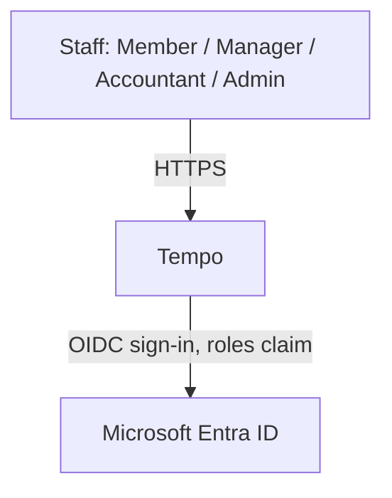
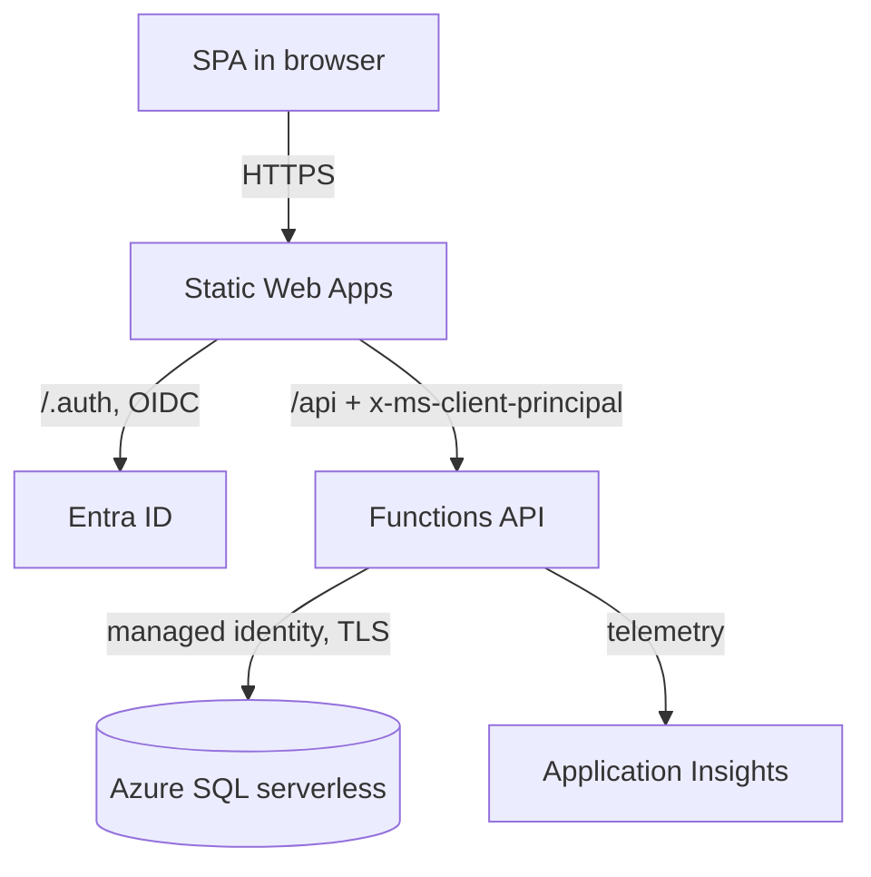

<!-- helix:publish audience=developer page=architecture kind=explanation voice=onboarding budget=1500 written=agent-opus reviewed=2026-10-29/agent-sonnet/081d3fef56f2b143 -->
<!-- helix:source docs/helix/02-design/architecture.md#level-1-system-context sha256:1726959394b69d00 -->
<!-- helix:source docs/helix/02-design/architecture.md#level-2-container-diagram sha256:1fb47758c15a5d35 -->
<!-- helix:source docs/helix/02-design/architecture.md#level-3-component-diagram sha256:76bf468a5a28b98b -->
<!-- helix:source docs/helix/02-design/architecture.md#module-boundaries sha256:67dd7f16e6642ba5 -->
<!-- helix:source docs/helix/02-design/architecture.md#quality-attributes sha256:5259ef0a45408ec1 -->
<!-- helix:source docs/helix/02-design/architecture.md#decisions-and-tradeoffs sha256:8293d4f18e7a2ba4 -->
<!-- helix:source docs/helix/02-design/adr/ADR-001-hosting-swa-linked-functions.md sha256:9bd45f1c492c4f1f -->
<!-- helix:source docs/helix/02-design/adr/ADR-002-datastore-azure-sql-serverless.md sha256:79361fa47dbd952a -->
<!-- helix:source docs/helix/02-design/adr/ADR-003-typescript-react-vite.md sha256:0e953d862243489c -->
<!-- helix:source docs/helix/02-design/adr/ADR-004-identity-entra-swa-roles.md sha256:846b6642bdd5588c -->
<!-- helix:source docs/helix/02-design/adr/ADR-005-time-model.md sha256:b09ed1205b518a8a -->
<!-- helix:source docs/helix/02-design/adr/ADR-006-period-close-enforcement.md sha256:1421b1e3bd0196b8 -->
<!-- helix:source docs/helix/02-design/adr/ADR-007-audit-trail.md sha256:79cf8135cdce7ac3 -->
<!-- helix:source docs/helix/01-frame/concerns.md sha256:4dc343af76d6770a -->
<!-- helix:source docs/helix/02-design/data-design.md sha256:4e13adc8da5cf9ab -->
<!-- helix:source docs/helix/02-design/security-architecture.md sha256:ec6ec158b7ee3f75 -->
<!-- helix:source .github/workflows/pages.yml sha256:2e645bcab9d4bae5 -->
# Architecture

## Context

Tempo is a single-tenant web app made of a React SPA, a serverless HTTP API, and an Azure SQL database. Staff sign in through the company's Entra ID tenant. Tempo depends on one external system, Microsoft Entra ID, which handles sign-in and app-role assignment over OpenID Connect.

| Element | Type | Purpose | Protocol |
|---------|------|---------|----------|
| Member, Manager, Accountant, Admin | User | Log time, approve entries, close periods, report, administer | HTTPS (browser) |
| Microsoft Entra ID | External | Sign-in and app-role assignment | OpenID Connect |
| Tempo | System | Time tracking, approval, period close, reports | HTTPS |



Payroll, invoicing, and chat integrations are outside the boundary. Tempo has no code that talks to them.

## Containers

Tempo has five containers: the SPA, Static Web Apps, the Functions API, the database, and telemetry. Every request from the browser passes through Static Web Apps (SWA). SWA handles sign-in and forwards `/api` calls with the user principal attached.

| Container | Technology | Responsibilities |
|-----------|------------|------------------|
| SPA | React, Vite, TypeScript | Screens, timer display, week view, client-side form validation |
| Static Web Apps | Azure SWA Standard | Hosts the SPA, redirects for sign-in, injects the user principal, routes `/api` |
| API | Azure Functions, Node.js 22, HTTP triggers, linked to SWA | Use cases, authorization policy, time-zone splitting, reports, CSV |
| Database | Azure SQL Database serverless | System of record, integrity rules, period-close trigger, audit log |
| Telemetry | Application Insights (OpenTelemetry) | Traces, errors, cold-start visibility |



The API trusts the `x-ms-client-principal` header from SWA and contains no token-validation code. The API accepts requests only from the linked SWA, so a client cannot forge the header ([ADR-004](../../helix/02-design/adr/ADR-004-identity-entra-swa-roles.md)). The API reaches the database with a managed identity and holds no SQL password ([ADR-001](../../helix/02-design/adr/ADR-001-hosting-swa-linked-functions.md)).

### Modules inside the containers

The code is planned as a pnpm workspace with six modules. The repository has no application code yet, so these paths do not exist on disk.

| Module (planned path) | Owns | May depend on | Must not depend on |
|-----------------------|------|---------------|--------------------|
| packages/contracts | Request and response schemas, types, error codes | Schema library only | domain, api, web |
| packages/domain | Pure rules: time-zone split, rates, budgets, authorization policy, period close | contracts (types only) | Any I/O, SQL, HTTP, Azure SDK |
| apps/api/src/http | Function handlers and principal parsing | application, contracts | persistence, domain internals |
| apps/api/src/application | Use cases and persistence ports, one transaction each | domain, contracts | http, mssql client |
| apps/api/src/persistence | SQL repositories, migrations, audit writer | domain types, contracts, mssql client | http, application |
| apps/web | Screens, API client, timer display | contracts | domain, api |

Handlers stay thin: they parse the request, authenticate the principal, call a use case, and map errors. The API wires ports to their implementations at startup in apps/api/src/main.ts. The command `pnpm check:boundaries` runs dependency-cruiser rules that mirror the table, and CI runs it.

## Deployment

Tempo deploys to two Azure targets: an SWA Standard site for the SPA, and a linked bring-your-own Functions app for the API. The Functions app runs on the Flex Consumption or Consumption plan. It also needs a storage account. Both targets and the database scale to zero when idle ([ADR-001](../../helix/02-design/adr/ADR-001-hosting-swa-linked-functions.md)).

| Resource | Configuration | Decision |
|----------|---------------|----------|
| Static Web Apps | Standard plan, custom Entra authentication, linked backend at `/api` | ADR-001, ADR-004 |
| Functions app | Node.js 22, HTTP triggers only, system-assigned managed identity | ADR-001 |
| Azure SQL Database | Serverless General Purpose, free offer while it covers usage, auto-pause on | ADR-002 |
| Entra application | Single tenant; app roles `Admin`, `Member`, `Accountant` | ADR-004 |
| Application Insights | OpenTelemetry, one trace per request | concerns.md `o11y-otel` |

The project concerns require infrastructure as code for every resource ([concerns](../../helix/01-frame/concerns.md)). Schema changes ship as plain versioned SQL migration files, which a small script runs in CI and at deploy ([data design](../../helix/02-design/data-design.md)).

The repository has no application deployment configuration yet. It has no infrastructure-as-code templates, no SWA configuration file, and no app build or deploy workflow. The two workflows in `.github/workflows/` build and check the documentation site, not Tempo itself.

```sh
ls .github/workflows
```

Expected result:

```text
guide.yml  pages.yml
```

`pages.yml` builds the documentation site with documentor and Hugo and publishes it to GitHub Pages on every push to `main`. `guide.yml` fails a pull request that leaves the guide behind the repository.

The architecture owner supplies the deployment pipeline and the infrastructure templates. Until then, the table above is the target deployment, not a running one.

## Quality targets

Tempo targets business-hours use at low cost, not high availability. Each target names how it is checked.

| Attribute | Target | Strategy | Verification |
|-----------|--------|----------|--------------|
| Availability | Business-hours use; no formal SLA | Managed PaaS; retry on database resume | Smoke test after deploy |
| Performance | p95 under 500 ms warm | Indexed date-range queries; narrow payloads | Load test at 50 users |
| Cold start | First request after idle may take several seconds | Accepted at launch | Cold-start measurement |
| Security | Server-side authorization on every call | Domain `Policy`, SWA edge auth, managed identity | Authorization test matrix |
| Cost | Under $30 per month | Scale-to-zero compute; auto-pause database | Azure Cost Management review at launch |
| Disaster recovery | RTO 1 day, RPO 1 day | Azure SQL automated backups with point-in-time restore | Restore drill before launch |

The cold start comes from two sources: the Functions app scaling from zero and the database resuming from auto-pause. A change should not add a keep-warm workaround without a measurement behind it ([ADR-002](../../helix/02-design/adr/ADR-002-datastore-azure-sql-serverless.md)). The [security architecture](../../helix/02-design/security-architecture.md) holds the full authorization matrix and threat list.

## Decisions that shape the code

Seven ADRs govern the architecture, and each one constrains where a kind of code may live. Read the ADR before changing the part it governs.

| ADR | Decision | What it means for the code |
|-----|----------|----------------------------|
| [ADR-001](../../helix/02-design/adr/ADR-001-hosting-swa-linked-functions.md) | Host the SPA on SWA with a linked Functions app | No database password in app settings; HTTP triggers only |
| [ADR-002](../../helix/02-design/adr/ADR-002-datastore-azure-sql-serverless.md) | Use Azure SQL Database serverless | No SQL logins; schema changes ship as versioned migrations |
| [ADR-003](../../helix/02-design/adr/ADR-003-typescript-react-vite.md) | Use strict TypeScript, React, and Vite in one pnpm workspace | The SPA imports API types from contracts and never redefines them |
| [ADR-004](../../helix/02-design/adr/ADR-004-identity-entra-swa-roles.md) | Use Entra through SWA custom auth, with roles from Entra app roles | The API reads the principal header; role checks run server-side |
| [ADR-005](../../helix/02-design/adr/ADR-005-time-model.md) | Store each entry with its time zone and split at local midnight | `local_date` is fixed at write time and never recomputed |
| [ADR-006](../../helix/02-design/adr/ADR-006-period-close-enforcement.md) | Enforce period close in the service and in a database trigger | Every write use case reads `settings.closed_through` under an update lock |
| [ADR-007](../../helix/02-design/adr/ADR-007-audit-trail.md) | Keep an append-only audit log in the database | Audit rows are written in the same transaction as the change |

ADR-004 has status Proposed, and the other six are Accepted. SPIKE-001 tests whether the SWA roles function receives the Entra `roles` claim when a linked Functions app is in use. If it does not, roles fall back to a `users.role` column that Admins manage.

A rule that must hold even when the code has a bug belongs in the database as well as in `domain`. Period close is a trigger for this reason, and the API's database identity has no `UPDATE` or `DELETE` on `audit_log`.

<details>
<summary>Follow-ups the architecture records against each decision</summary>

- ADR-001: confirm the monthly cost against the $30 target.
- ADR-002: measure headroom on the Azure SQL free offer; fall back to paid serverless if usage exceeds it.
- ADR-004: SPIKE-001 must confirm the roles claim reaches the roles function.
- ADR-003, ADR-005, ADR-006, ADR-007: none.
- Source: the Decisions and Tradeoffs table in `docs/helix/02-design/architecture.md`.

</details>

For the tables, keys, and the time and money model behind ADR-005 to ADR-007, see the [Data overview](../data/index.md). For what Tempo is and how one request moves through it, see the [Overview](index.md).
