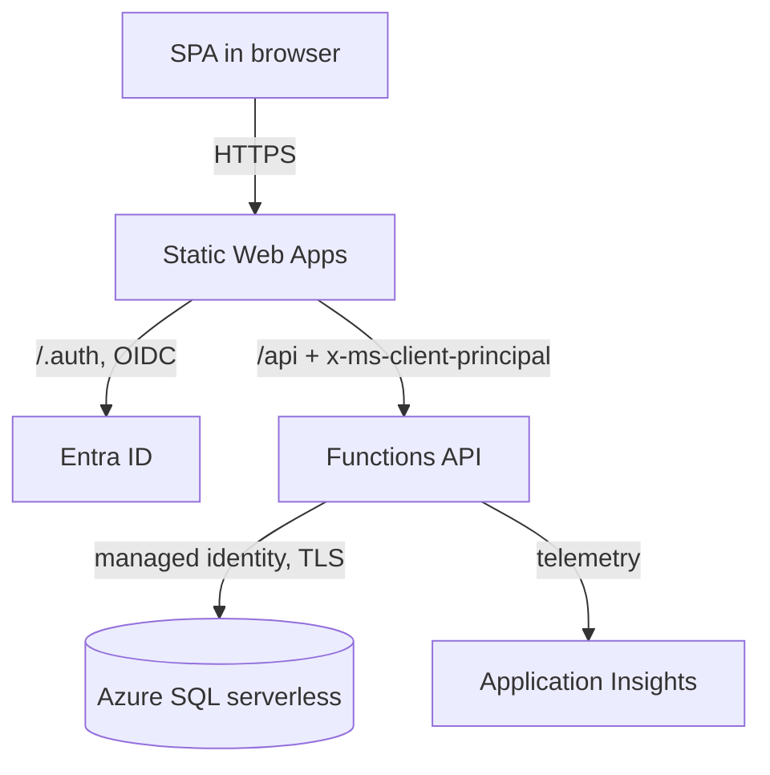

<!-- helix:publish audience=developer page=index kind=explanation voice=onboarding budget=800 written=agent-opus reviewed=2026-10-29/agent-sonnet/acdce0c53c0deaa7 -->
<!-- helix:source docs/helix/00-discover/product-vision.md sha256:9b53a7d443020c1a -->
<!-- helix:source docs/helix/02-design/architecture.md#level-1-system-context sha256:1726959394b69d00 -->
<!-- helix:source docs/helix/02-design/architecture.md#level-2-container-diagram sha256:1fb47758c15a5d35 -->
<!-- helix:source docs/helix/02-design/architecture.md#module-boundaries sha256:67dd7f16e6642ba5 -->
<!-- helix:source docs/helix/02-design/architecture.md#architecture-walkthrough sha256:17918f909d9fd996 -->
<!-- helix:source docs/helix/02-design/contracts/CONTRACT-001-tempo-api.md sha256:84238847ace8ef0d -->
# Overview

## What it is

Tempo is a time-tracking and light task-management web app for Synaptiq staff, and it replaces Everhour. Staff log time against projects and tasks with a timer or by hand. Project managers approve entries, Accountants close accounting periods, and Admins can override either one. Reports group hours by day, week, or month and export to CSV.

Tempo signs users in through the company's Entra ID tenant and runs on serverless Azure. It is designed to cost under $30 a month and to keep all time data in Synaptiq's own subscription.

The repository has no application code yet. It holds the governed design under `docs/helix/`, and the module layout below is the planned layout for the code.

```sh
ls docs/helix/02-design
```

Expected result:

```text
adr  architecture.md  contracts  data-design.md  security-architecture.md  spikes  umf
```

## The parts

Tempo has five containers, and one system outside its boundary handles sign-in. Entra ID handles sign-in and app-role assignment over OpenID Connect. Payroll, invoicing, and chat integrations are also outside the boundary.

| Container | Technology | What it does |
|-----------|------------|--------------|
| SPA | React, Vite, TypeScript | Renders every screen, the timer, and the week view |
| Static Web Apps | Azure SWA Standard | Hosts the SPA, runs sign-in, and routes `/api` |
| API | Azure Functions, Node.js 22, HTTP triggers | Runs use cases, authorization, time-zone splitting, reports, and CSV |
| Database | Azure SQL Database serverless | Holds the records, integrity rules, the period-close trigger, and the audit log |
| Telemetry | Application Insights (OpenTelemetry) | Collects traces, errors, and cold-start data |



The code is planned as a pnpm workspace with six modules. Each module has allowed and forbidden dependencies, and the boundary check enforces them in CI. Use the table to find where a change belongs.

| Module (planned path) | A change belongs here when it… |
|-----------------------|--------------------------------|
| packages/contracts | changes a request shape, a response shape, or an error code |
| packages/domain | changes a pure rule: time-zone splitting, rates, budgets, authorization policy, or period close |
| apps/api/src/http | changes how a handler parses input, reads the principal, or maps errors |
| apps/api/src/application | changes a use case, such as starting a timer or closing a period |
| apps/api/src/persistence | changes SQL, a migration, a repository, or the audit writer |
| apps/web | changes a screen, the API client, or the timer display |

Dependencies flow in one direction. The `web` module depends only on `contracts`, and the `domain` module does no I/O.

Handlers call use cases, and use cases reach the database only through ports. The API wires ports to their implementations at startup, in main.ts.

A rule that must hold even when code has a bug belongs in the database, not only in `domain`. The period-close check is a database trigger for this reason ([ADR-006](../../helix/02-design/adr/ADR-006-period-close-enforcement.md)).

## One request

Stopping a timer shows every part at work. A timer that runs past local midnight becomes two entries.

```mermaid
sequenceDiagram
    participant B as SPA
    participant S as SWA
    participant A as API
    participant D as Azure SQL
    B->>S: POST /api/timer/stop
    S->>A: forward with x-ms-client-principal
    A->>D: BEGIN; read running timer and settings (update lock)
    A->>A: domain.splitAtLocalMidnight(start, end, tz)
    A->>D: insert entries (trigger checks closed period)
    A->>D: delete timer; insert audit rows; COMMIT
    A-->>B: 200 entries
```

1. The SPA sends `POST /api/timer/stop` with an optional note.
2. Static Web Apps checks the session and forwards the call with the user principal in the `x-ms-client-principal` header. The API reads identity from that header and has no token code ([ADR-004](../../helix/02-design/adr/ADR-004-identity-entra-swa-roles.md)).
3. The handler calls the stop-timer use case, which runs in one transaction.
4. The use case locks and reads the running timer and the user's settings.
5. The `domain` split function cuts the span at local midnight in the entry's time zone ([ADR-005](../../helix/02-design/adr/ADR-005-time-model.md)).
6. The persistence layer inserts the entries, deletes the timer, writes audit rows, and commits. The database trigger rejects any segment in a closed period, and the API then returns 409 `PERIOD_CLOSED`.

The API reaches Azure SQL with a managed identity, so no database password exists in app settings ([ADR-001](../../helix/02-design/adr/ADR-001-hosting-swa-linked-functions.md)).

<details>
<summary>Evidence for this flow</summary>

- The sequence comes from the architecture walkthrough in `docs/helix/02-design/architecture.md`.
- The endpoint, the split rule (FR-24), and the 409 `PERIOD_CLOSED` response come from `docs/helix/02-design/contracts/CONTRACT-001-tempo-api.md`.
- The proving tests are planned: domain split tests for month end and DST days, and an API test against a real schema for the closed-period trigger.
- ADR-004 is Proposed. `docs/helix/02-design/spikes/SPIKE-001-entra-roles-claim.md` tests whether the roles claim arrives as designed and gives a fallback.

</details>

## Where to go next

Read the document that matches the part you are changing.

- [Architecture](architecture.md) covers containers, components, module boundaries, and quality targets in depth.
- [Data overview](../data/index.md) covers tables, keys, and the time and money model.
- [Product vision](../../helix/00-discover/product-vision.md) explains who uses Tempo and why it exists.
- [PRD](../../helix/01-frame/prd.md) lists the numbered requirements (`FR-n`) that every change traces to.
- [API contract](../../helix/02-design/contracts/CONTRACT-001-tempo-api.md) defines every endpoint, its roles, and its error codes.
- [Security architecture](../../helix/02-design/security-architecture.md) covers roles, authorization, and secrets.
- The [ADRs](../../helix/02-design/adr/) record why each technology was chosen.

The repository has no generated system or context view. The Mermaid diagrams in the architecture document are the only system views.
