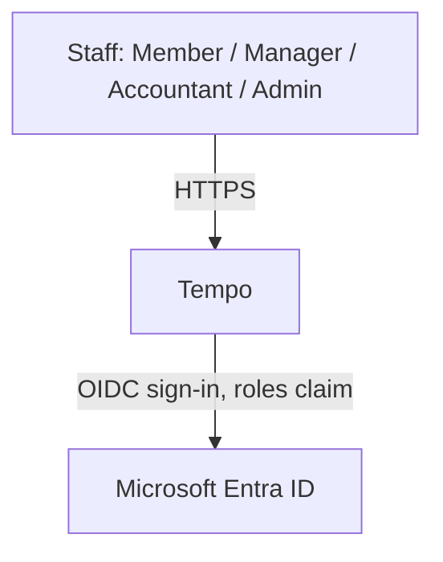
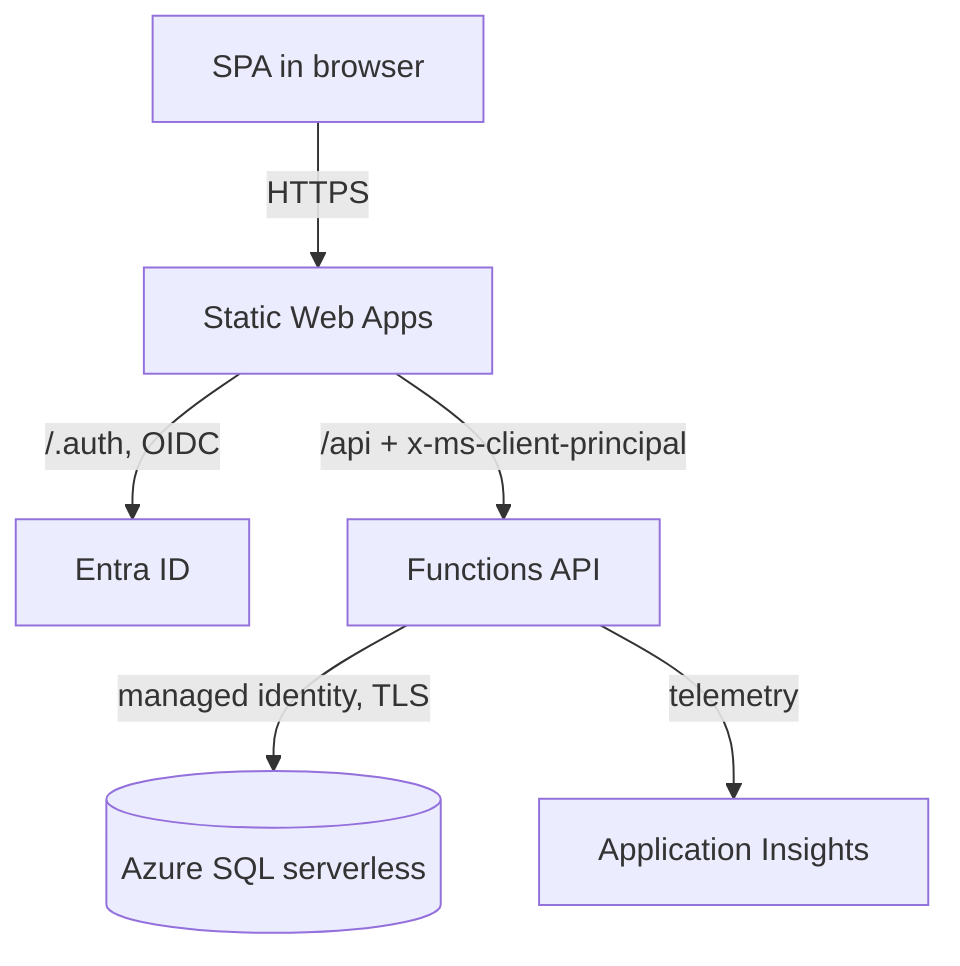

---
ddx:
  id: architecture
  authoring:
    home: repo
  links:
    - prd
    - ADR-001
    - ADR-002
    - ADR-003
    - ADR-004
---

# Architecture

## Scope

Tempo, the time-tracking web app described in `01-frame/prd.md`: a single-tenant React SPA, a serverless HTTP API, and an Azure SQL database, authenticated through the company's Entra ID tenant. Outside the boundary: Entra ID itself, payroll and invoicing systems, and chat integrations.

## Level 1: System Context

| Element | Type | Purpose | Protocol |
|---------|------|---------|----------|
| Member, Manager, Accountant, Admin | User | Log, approve, close periods, report, administer | HTTPS (browser) |
| Microsoft Entra ID | External | Sign-in and app-role assignment | OpenID Connect |
| Tempo | System | Time tracking, approval, period close, reports | HTTPS |



## Level 2: Container Diagram

| Container | Technology | Responsibilities | Communication |
|-----------|------------|------------------|---------------|
| SPA | React, Vite, TypeScript | All screens; timer display; week view; client-side form validation | HTTPS to SWA |
| Static Web Apps | Azure SWA Standard | Hosts the SPA; sign-in redirects; injects the user principal; routes `/api` | HTTPS; OIDC to Entra |
| API | Azure Functions (Node.js 22, HTTP triggers), linked to SWA | Use cases, authorization policy, time-zone splitting, reports, CSV | HTTPS from SWA; SQL over TLS |
| Database | Azure SQL Database serverless | System of record, integrity rules, period-close trigger, audit log | T-SQL, Entra managed identity |
| Telemetry | Application Insights (OpenTelemetry) | Traces, errors, cold-start visibility | OTLP/SDK |



## Level 3: Component Diagram

| Component | Container | Purpose | Notes |
|-----------|-----------|---------|-------|
| `contracts` | shared package | Request and response types and validation schemas | Source of truth for CONTRACT-001 shapes |
| `domain` | shared package | Pure rules: time-zone splitting, rate resolution, budget math, authorization policy, period-close rule | No I/O; unit-tested heavily |
| `api/http` | API | Function handlers: parse, authenticate principal, call a use case, map errors | Thin |
| `api/application` | API | Use cases (start timer, approve entries, close period, run report) in one transaction each | Depends on domain and persistence ports |
| `api/persistence` | API | SQL repositories, migrations, audit writer | Implements ports |
| `web` | SPA | Screens and API client | Depends on contracts only |

## Module Boundaries

**Source Applicability**: source; handwritten TypeScript in a pnpm workspace.

| Module | Responsibility / Owned Types | Public API | Allowed Dependencies | Forbidden Dependencies |
|--------|------------------------------|------------|----------------------|------------------------|
| `packages/contracts` | API request/response schemas and types; error codes | Exported schemas and types | none (schema library only) | domain, api, web |
| `packages/domain` | Entry, TimeSpan, Money, RateTable, Policy, PeriodClose; split and rate functions | Pure functions and types | contracts (types only) | any I/O, SQL, HTTP, Azure SDK |
| `apps/api/src/http` | Function handlers and principal parsing | Function registrations | application, contracts | persistence, domain internals |
| `apps/api/src/application` | Use cases and persistence ports | `UseCases` interface | domain, contracts | http, mssql client |
| `apps/api/src/persistence` | SQL repositories, migrations, audit writer | Port implementations | domain types, contracts, mssql client | http, application |
| `apps/web` | Screens, API client, timer display | none (leaf) | contracts | domain, api |

Integration owner for wiring ports to implementations: `apps/api/src/main.ts` (construction at startup). Boundary command: `pnpm check:boundaries` (dependency-cruiser rules mirroring this table), run in CI.

## Quality Attributes

| Attribute | Target | Strategy | Verification |
|-----------|--------|----------|--------------|
| Availability | Business-hours use; no formal SLA | Managed PaaS; retry on database resume | Smoke test after deploy |
| Performance | p95 under 500 ms warm; first request after idle may take several seconds | Indexed date-range queries; narrow payloads | Load test at 50 users; cold-start measurement |
| Security | Server-side authorization on every call | Domain `Policy`; SWA edge auth; managed identity | Authorization test matrix; see security-architecture |
| Cost | Under $30 per month | Scale-to-zero compute, auto-pause database | Azure Cost Management review at launch |
| Disaster Recovery | RTO 1 day / RPO 1 day | Azure SQL automated backups with point-in-time restore | Restore drill before launch |

## Decisions and Tradeoffs

| Decision | Status | Rationale | Follow-up |
|----------|--------|-----------|-----------|
| ADR-001 SWA plus linked Functions | Accepted | Passwordless database access, serverless | Confirm monthly cost |
| ADR-002 Azure SQL serverless | Accepted | Relational integrity, low idle cost | Measure free-offer headroom |
| ADR-003 TypeScript, React, Vite | Accepted | One language, static hosting | none |
| ADR-004 Entra via SWA, roles claim | Proposed | No token code in the API | SPIKE-001 |
| ADR-005 Time model | Accepted | Exact local days and months | none |
| ADR-006 Period close enforcement | Accepted | Guarantee survives code bugs | none |
| ADR-007 Audit log | Accepted | Tamper-resistant history | none |

## Architecture Walkthrough

Question: how does stopping a timer across local midnight become two entries? Audience: implementers.

```mermaid
sequenceDiagram
    participant B as SPA
    participant S as SWA
    participant A as API
    participant D as Azure SQL
    B->>S: POST /api/timer/stop
    S->>A: forward with x-ms-client-principal
    A->>D: BEGIN; read running timer and settings (update lock)
    A->>A: domain.splitAtLocalMidnight(start, end, tz)
    A->>D: insert entries (trigger checks closed period)
    A->>D: delete timer; insert audit rows; COMMIT
    A-->>B: 200 entries
```

Proving tests: domain split tests (month end, DST days), an API test against a real schema for the closed-period trigger.
